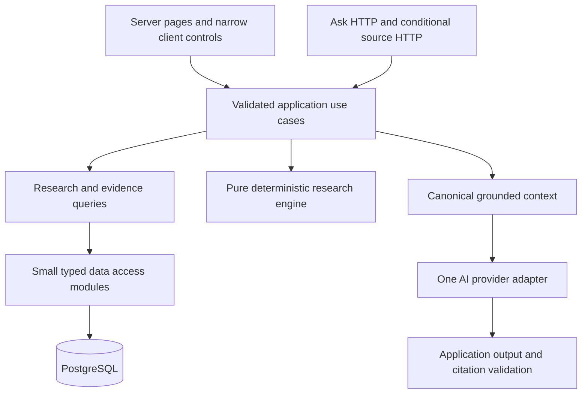

# MARKET AI backend architecture

System Design Gate 1, 2026-09-16. Documentation only. This design recommends PostgreSQL and Drizzle for later authorized implementation; it installs neither, selects no hosting/AI vendor, and creates no migrations or server code. Scope remains the [PRD](../product/PRD.md), including all eight routes and the final full-stack/grounded-AI release gate.

## Modular monolith

One Next.js application owns the public UI, server use cases and database access. Separate modules by responsibility, not separately deployed services. Preserve the current pnpm/Next/React versions and [server-first frontend](FRONTEND_ARCHITECTURE.md). No microservices, event bus, Kafka, Kubernetes, Redis, Elasticsearch, GraphQL, realtime feed or vector database.

| Layer | Owns | Does not own |
| --- | --- | --- |
| Routes/UI | URL parsing boundary, HTTP transport, accessible states, navigation, session draft | Financial math, raw SQL, provider credentials, invented evidence |
| Application use cases | Resolve dataset/cutoff/entity, validation, coherent read orchestration, domain errors, retrieval and response validation | JSX, peer rules duplicated in controllers, provider-specific DTOs throughout app |
| Research/query services | Snapshot selection, comparisons, discovery, source reading; pure versioned engine used during generation or explicit deterministic reads | User-editable scores or LLM-established research |
| Repositories | Specific typed relational reads and developer-only transactional writes; return domain data | Generic repository framework, business presentation rules, public CRUD for every entity |
| Database | Input relationships, uniqueness, exact decimals, immutable published outputs | Unversioned calculation triggers competing with the TypeScript methodology |
| AI adapter | Transport one validated context/question to a later chosen provider; translate transport errors | Retrieval policy, facts, scoring, tool execution, financial write permission |

Prefer plain functions and focused modules; the layers do not require a class/interface for every query. Keep domain calculations independent of DB/ORM and browser imports. Runtime public DB credentials are read-only; a separate developer/CI migration credential is used only for authorized data setup. A server-only import boundary and explicit response shaping protect secrets and unnecessary source payloads.

## Database engine decision

| Consideration | PostgreSQL | SQLite |
| --- | --- | --- |
| Integrity and types | Relational constraints and exact numeric types fit explicit monetary/period contracts. | Relational constraints work, but exact decimal conventions need more application discipline. |
| Web concurrency and deployment | Client/server engine separates durable storage from application instances; handle connection budgets explicitly. | Excellent simple local/file deployment and sufficient for this mostly-read workload; deployment must provide durable file ownership. |
| Setup/migrations/testing | More setup and a DB service; repeatable migrations/seeds and integration tests on the same engine. | Very low local setup; file tests are easy, but substituting it for production PostgreSQL would conceal dialect/type differences. |
| Cost and learning | Requires a low-cost DB deployment choice; useful explicit SQL/transaction/query experience. | Lower infrastructure burden; also legitimate engineering, not inferior merely for CV branding. |

**Recommend PostgreSQL**, primarily for exact financial types and a clear durable client/server boundary across local and eventual hosted execution, not because 12 companies need massive scale. SQLite could serve this read-heavy dataset; its single-writer model is not itself a current bottleneck. The deployment/file tradeoff and precision discipline favor PostgreSQL here. No cloud vendor or engine patch version is selected. The engine supports [exact numeric storage](https://www.postgresql.org/docs/current/datatype-numeric.html) and [MVCC concurrency](https://www.postgresql.org/docs/current/mvcc-intro.html); SQLite's own [deployment guidance](https://www.sqlite.org/whentouse.html) explains its appropriate embedded uses and writer constraint. These technical references inform the choice, not project capacity claims.

## Query layer decision

| Option | Type safety and schema ownership | Workflow / tradeoff |
| --- | --- | --- |
| Drizzle | TypeScript schema and typed SQL-oriented queries; explicit constraints still required. | Generated SQL migrations can be reviewed; direct SQL remains visible. Fits small query modules without a generic repository abstraction. Runtime validation and decimal conversion remain application duties. |
| Prisma | Typed model/query tooling with a dedicated schema/contract workflow. | Good relational developer experience; adds a distinct modeling/tool workflow to learn and verify. Current major-version workflows must be checked before adoption, not assumed from old tutorials. |
| Direct SQL/driver | Full SQL ownership; parameterized queries and manually maintained result codecs/types. | Small conceptual surface, but more hand-maintained type/migration plumbing and risk of drift for the statement/snapshot relationships. |

**Recommend Drizzle with PostgreSQL**, because explicit relational constraints, SQL review and TypeScript visibility suit this educational model. This is a design preference, not an unmeasured bundle-speed claim. [Drizzle schema documentation](https://orm.drizzle.team/docs/sql-schema-declaration) and [migration workflow](https://orm.drizzle.team/docs/migrations) describe the schema-to-SQL approach; [Prisma's current documentation](https://www.prisma.io/docs/orm) confirms its alternative typed workflow. Select compatible package/driver versions and exact decimal arithmetic support in the separately authorized implementation milestone, without changing the verified frontend foundation. Drizzle adds a dependency/toolchain, even with its modest SQL-oriented abstraction and PostgreSQL support. TypeScript typing does not replace database constraints. Parameterized raw SQL remains appropriate when it makes a query clearer; return values still need typed/runtime validation. Do not install an ORM now. Keep generated migration review and DB integration tests regardless of tooling.

## Server access and HTTP boundaries

Server Component → application/query function → repository → database is the ordinary read path. Do not call the app's own HTTP endpoints from Server Components. Read installed Next.js guidance before implementation; this design checked bundled `01-app/01-getting-started/06-fetching-data.md` and `15-route-handlers.md`. Server-side ORM reads are supported; route handlers are distinct transport boundaries, with caching explicit rather than assumed.

One browser HTTP interface is required: explicit Ask submission. Source HTTP is conditional on lazy-loading omitted full bodies; content already included with a page opens locally. Search suggestions use a compact server-provided safe identity index and local matching, with the same pure matcher used by submitted server search. [API_CONTRACT.md](API_CONTRACT.md) specifies them. Directory filtering/search submission, Stock view/period/range selection, Decision navigation and all ordinary page reads use URL navigation and server rendering. Chart receives the selected bounded series and accessible table in that render; point selection stays local. No separate chart/filter/CRUD endpoints, no Server Actions required for public financial writes, no streaming requirement. HTTP source access does not create a new public product page or URL-owned reader state.

## Dataset and research flow

Developer input manifest → validate typed records/relationships → execute pure formulas at three cutoffs/three horizons → persist outputs plus exact input/method references → validate whole dataset → publish one version. Full coverage is 15 issuers, 12 listings, four offers, four sectors and 108 Stock snapshots, unchanged. The [model](../data/DATA_MODEL.md) and [method](../research/RESEARCH_METHODOLOGY.md) own exact details. Frontend requests never seed missing rows or generate replacement scores.

At request entry resolve one published dataset version and cutoff. Every nested query and response uses that pinned context. Default cutoff is the dataset reference time; safe historical contexts are only the declared three cutoffs or a stored IPO evaluation. The current quote, scenario, finding and What Changed view use that same selection policy. An unavailable component does not silently substitute another company's result. Unknown routes produce proper not-found outcomes; known entity with missing research is explicit unavailable, not 404 or empty successful research.

## Grounded AI without vector infrastructure

Entity/intent resolution → eligible snapshot and deterministic result fields → supported findings and input provenance → relevant published articles/documents/events or reviewed concept → bounded context → one provider adapter → application validation → cited response.

The fixed universe has 15 issuers, a small source corpus and explicit relevance links. Structured relational retrieval is sufficient; semantic nearest-neighbor infrastructure supplies no required capability. Match canonical aliases and curated intent/concept choices; unresolved language returns clarification or a supported-scope limitation, not guessed company facts. No arbitrary internet browsing, external URL retrieval, SQL generation or agent tool execution is granted to the model.

Retrieval priority: material risks/missingness first, requested facts next, their support, then relevant changes and contextual events. Retrieve only evidence published by the pinned cutoff. Comparison independently resolves both companies at compatible bases; market Ask reuses Home; concept Ask uses reviewed teaching content. Context includes evidence IDs, supported claim/rule IDs, input/metric references, units, dates and limitations. Sources may be excerpted with stable section locators; no omitted caveat can reverse meaning. If the required context cannot fit the configured bounded payload, narrow/qualify the answer or request clarification; never drop a material concern invisibly.

## Provider and validation boundary

One conceptual adapter operation, generateGroundedAnswer(context, question, explanationLevel), accepts application-owned context and returns structured explanation blocks with claim references, or a typed transport failure. It knows no database credentials and cannot change context. Do not create a general multi-provider framework or select a model now.

The application validates result shape, known context/source IDs, context digest, numerical field references and claim support. Render financial numbers/categories from canonical result references, not model-provided replacements. Reject unknown citations, references unavailable at cutoff, invented conclusions and new financial assertions. To make validation tractable, v1 factual answer blocks select from the retrieved canonical claims/templates; generated prose may connect/explain those claims but cannot introduce unsupported issuer-specific facts. A source ID that exists is insufficient if it does not support that claim. Concept explanation must stay within the reviewed concept boundaries.

Unverifiable output is rejected with an honest answer-validation failure; safe supported portions may be presented as partial only when their qualification is explicit. No fallback static answer is represented as generated. Provider unavailable/timeout has Retry/Edit under INT-014, while ordinary research remains available. Evaluation uses reviewed question/attack cases and claim-level checks; this contract is not a guarantee that arbitrary free-form prose can be perfectly automatically fact-checked. Final implementation must prove the constrained answer path before expanding prose freedom.

## Cache and freshness

| Content | Initial policy |
| --- | --- |
| Identities, financial inputs, price series, evidence | Immutable per dataset version; direct DB reads initially, request-level deduplication where useful. Source responses may use version/digest validators with revalidation; no implicit forever-cache of active-version resolution. |
| Research snapshots/scenarios | Persisted versioned outputs. Cache keys, if measured need justifies caching, include dataset, cutoff, method, entity and horizon; level additionally keys rendered explanation, not research truth. |
| Market current | Resolve deployment's active version once, derive at its reference cutoff; no wall-clock live refresh. No separate realtime market store. |
| Ask | No shared answer cache or persisted conversation. Response no-store; local session memory only. |

Deploying a new active dataset version is the invalidation boundary. Requests already pinned to an older retained version may finish consistently; reject unknown/retired versions with explicit context-expired recovery. No distributed invalidation infrastructure. Start with straightforward queries and bounded payloads; only add cross-request caching after measurements. AI is expected to dominate variable latency/cost, an architectural expectation to verify rather than a measured claim.

## Transactions and publication

Developer-only seed/import writes run in transactions for coherent groups: evidence parent/subtype/relevance; complete statement groups; IPO terms/holders/reservations/allocations; snapshot inputs/findings/results/scenarios. Cross-record equations are application validation plus database constraints where expressible. A foreign key alone cannot prove arithmetic reconciliation or a claim's support.

Build a draft version while published versions remain immutable/readable. Generate all required outputs against that draft, validate referential/temporal/numerical/coverage invariants, then publish the validated manifest atomically. The activation configuration points only to a published version. At this scale one generation transaction may be adequate; do not hold it open across AI/network calls. Import retries use stable keys and content digests: identical replay is a no-op, conflicting content under the same immutable version is rejected. Failure rolls back the group and cannot activate incomplete data. Regeneration creates a new version, never patches released snapshots in place. No user-facing write API is added to demonstrate transactions.

## Security, observability and cost

DB/provider credentials stay server-only; inputs are validated before data lookup and all queries are parameterized. Safe framework rendering escapes text; no arbitrary HTML or provider-supplied links. No auth/profile/broker/payment/account/portfolio feature. Transient Ask context from the client is not trusted research; re-fetch canonical claims for every request. Provider/platform retention and log settings must satisfy NFR-006 before connection. Do not persist prompts as application history.

Log request correlation, operation, duration, dataset/method version and sanitized failure class. No raw question/answer, secrets or personal identifiers in application logs. Short-lived abuse-control counters are operational metadata, not accounts. [Server contract](API_CONTRACT.md#resource-and-security-policy) defines admission controls; public AI must remain disabled until deployment-wide enforcement and provider budget controls are configured. There is no distributed in-memory rate-limit assumption.

Performance verification records cold/warm server reads, render, suggestions/source latency and AI separately on chosen hosting. Database connection/pool limits, execution time limits and monetary quota must be set after hosting/provider selection. No fake enterprise SLA. No enterprise analytics/observability or feature-flag service is needed; an ordinary server configuration can disable unavailable Ask generation honestly.

## First vertical slice

Planning only, after approval of this design and a separate dataset-design task: one fictional listed issuer/listing, its calendar/closes, typed financial periods and real supporting synthetic evidence → transactional database setup → deterministic metrics/pillars/Risk → one Long research snapshot → server query use case → Stock Overview with loading/error/not-found and source access → calculation and relational integration checks.

This slice exercises DB, engine, server boundary and responsive frontend rather than hardcoded literals. Without two peers, Price vs Value/scenarios and consequently some composite output remain explicitly unavailable; without a prior snapshot, What Changed is unavailable. Do not manufacture the missing peers/baseline or claim final Release 1. Only functioning sections/actions are exposed; all six views and full coverage remain the final target. Grounded AI is later implemented, not represented by a fake running request in this slice.

The five [visual references](../product/PRD.md#prd-011-visual-and-architecture-prerequisites) are still required before their relevant frontend presentation work. Data/engine/query design and tests can proceed independently. Scope the slice's frontend after the necessary Stock/Context Help references are supplied; do not waive Pro/mobile/help prerequisites by calling it a prototype. No company or financial record is created now.

## Open implementation decisions

Still needed: actual fictional identities/calendar/records and evidence copy; supported PostgreSQL/Drizzle/driver/decimal package versions; physical schema/migration realization; hosting and connection quotas; AI provider/model, provider retention and token/cost envelope; numerical performance budgets from the selected environment; visual references. The logical model, methods, local search contract, Ask interface and conditional source interface are specified here. These remaining choices do not authorize implementation during this task.
